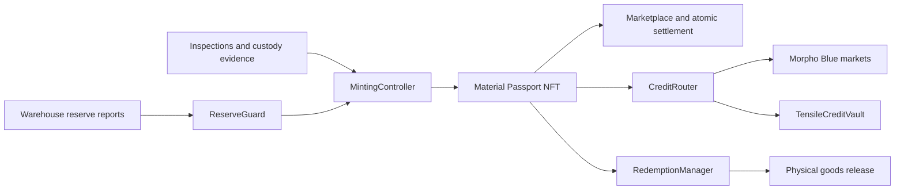

# Tensile

**Tokenized industrial materials, connected to digital markets and credit.** Tensile is an on-chain protocol for representing verified physical material lots, tracking evidence about their custody and reserves, and enabling compliant trading, borrowing, and redemption.

| | |
|---|---|
| Live application | [tensile-fe-dd97187f9ab9.herokuapp.com](https://tensile-fe-dd97187f9ab9.herokuapp.com/) |
| Application repository | [github.com/pawp5/tensile-app](https://github.com/pawp5/tensile-app) |
| X | [@TensileDev](https://x.com/TensileDev) |
| Demo video | [Watch the demo](https://www.youtube.com/watch?v=XLPaATkvEng) |

> This repository contains Tensile's Solidity protocol and Foundry deployment scripts. The protocol is a development-stage project and has not been audited. Review [SECURITY_REVIEW.md](./SECURITY_REVIEW.md) before interacting with or deploying contracts.

## Mission

Industrial materials are valuable, but ownership, quality, location, and custody information can be difficult to verify and use across markets. Tensile aims to make material inventories easier to verify and finance by linking on-chain lot tokens to warehouse reserve reports and operational attestations.

The protocol is designed to connect physical supply-chain records with programmable ownership and credit. It does not itself inspect, store, or insure physical goods: trusted operators and independent signers provide the off-chain evidence the contracts check.

## Protocol overview

Each material lot is represented by a **Material Passport**, an ERC-721 token containing the lot's material, quantity, and warehouse references. A mint follows a review and custody process, then checks that the warehouse's reported reserves can cover the total tokenized quantity. Transfers are identity-gated, and a reserve breach or stale report can cause the warehouse to be frozen.

Verified lots can be listed and sold through the marketplace, with payment and title transfer settled atomically. A holder can also pledge a lot to borrow a stablecoin through an isolated Morpho Blue market. The `CreditRouter` owns the Morpho position and enforces Tensile's borrowing checks. Holders can repay and reclaim a lot, while a marketplace sale can pay off its outstanding debt as part of settlement. Redemption uses a request and warehouse release confirmation before the passport is burned.



## Features

- **Evidence-backed tokenization:** staged minting with AI review, inspection, custody confirmation, and a reserve check.
- **Warehouse proof of reserve:** signed reserve updates from warehouse and inspector signers; stale or insufficient reserves can block minting and freeze a warehouse.
- **Material Passports:** ERC-721 lot tokens with transfer restrictions and attestations.
- **Identity controls:** KYC allow-list checks for users and protocol contracts.
- **Lending against lots:** an ERC-4626 lender vault supplies liquidity to per-lot Morpho Blue markets; the router manages collateral and debt.
- **Marketplace:** listings, private buyer restrictions, bids, and atomic delivery-versus-payment settlement, including loan payoff on sale.
- **Physical redemption:** warehouse release confirmation is recorded before a lot token is burned.
- **Price and risk controls:** material and region price feeds, valuation haircuts, stablecoin peg checks, class-level lending limits, and reserve circuit breakers.
- **Role-based operations:** separate admin, KYC, risk, inspector, price updater, and protocol contract roles.

## Repository layout

| Path | Contents |
|---|---|
| `src/asset/` | Material passports, minting, attestations, warehouses, redemption |
| `src/credit/` | Morpho market registry, credit router, lot wrappers, lender vault |
| `src/identity/` | Identity allow-list and protocol contract registry |
| `src/market/` | Marketplace, fee accounting, trade price index |
| `src/pricing/` and `src/reserve/` | Valuation feeds, reserve reports, safety checks |
| `script/` | Deployment, onboarding, role management, and local demo scripts |
| `test/` | Foundry tests |
| `deployments/` | Chain deployment address files generated by the deployment script; ignored by Git |

## Requirements

- [Foundry](https://getfoundry.sh/), including `forge`
- Git
- An RPC endpoint and funded deployer wallet for deployment

## Build and local demo

Install dependencies and compile:

```sh
./setup.sh
```

Run the local end-to-end demo without broadcasting transactions:

```sh
forge script script/DemoFlow.s.sol -vv
```

## Deploy

Deployment scripts use Foundry's environment variables. Start with the example file and keep real secrets in the ignored `.env` file:

```sh
cp .env.example .env
```

Set `PRIVATE_KEY`, `EXPECTED_CHAIN_ID`, and the RPC URL for the target network. For a production deployment, also configure the real stablecoin address (`USDC`), Morpho Blue (`MORPHO`), and enabled interest-rate model (`IRM`). Review the network, addresses, stablecoin decimals, admin, and risk settings before broadcasting.

Deploy the protocol:

```sh
forge script script/Deploy.s.sol --rpc-url monad_testnet --broadcast
```

The script writes contract addresses to `deployments/<chainId>.json`. The `monad_testnet` alias reads `MONAD_TESTNET_RPC_URL`; set `EXPECTED_CHAIN_ID=10143` for that network. For test deployments only, a mock stablecoin and isolated Morpho instance can be explicitly enabled:

```sh
DEPLOY_MOCK_USDC=true DEPLOY_LOCAL_MORPHO=true \
  forge script script/Deploy.s.sol --rpc-url monad_testnet --broadcast
```

Onboard a warehouse and material class after deployment. The signer must hold `ADMIN`; the script registers one warehouse and one material/region class, creates its reserve and price feeds, and enables its Morpho oracle configuration.

```sh
forge script script/Onboard.s.sol --rpc-url monad_testnet --broadcast
```

Set the onboarding values in `.env` (`OPERATOR`, `REGION`, `WH_SIGNER`, `INSP_SIGNER`, `MATERIAL`, and `INITIAL_PRICE`). See comments in [.env.example](./.env.example) and the scripts for all supported options. Onboarding temporarily grants `RISK_ADMIN` to the signer when needed; review roles and complete the admin handover after setup.

**Production checklist:** use a multisig admin, use verified production token/Morpho/IRM addresses, configure stablecoin price protection where available, protect signer keys, set conservative class risk parameters, and complete a deployment and role review before enabling real collateral or liquidity. The scripts check chain IDs, contract code, and Morpho parameter enablement, but those checks do not establish that an address is an official deployment. Do not enable mock assets on production networks.

## Core contracts

| Contract | Responsibility |
|---|---|
| `MaterialPassport` | ERC-721 lots and transfer gating |
| `MintingController` | Coordinates evidence, custody, reserve checks, and minting |
| `AttestationRegistry` | Append-only log of operational attestations |
| `WarehouseRegistry`, `TensileReserveFeed`, `ReserveGuard` | Warehouse setup, signed reserve data, and reserve health controls |
| `IdentityRegistry`, `TensileAccessManager` | Identity verification and role permissions |
| `TensilePriceFeed`, `PriceOracleAdapter` | Material valuation, haircuts, and stablecoin guard |
| `MarketRegistry`, `TensileMorphoOracle`, `LotWrapper` | Per-class and per-lot Morpho market configuration |
| `TensileCreditVault`, `CreditRouter` | Lender deposits, borrowing, repayment, and collateral release |
| `Marketplace`, `FeeCollector`, `PriceIndex` | Listings, bids, settlement, fees, and trade reporting |
| `RedemptionManager` | Redemption requests and confirmed warehouse releases |

## Security and risk

This code handles tokenized claims and credit flows, but on-chain checks cannot independently prove that physical materials exist or meet a specification. Reserve reports, inspections, identity decisions, price updates, stablecoin behavior, warehouse operations, and Morpho liquidity all introduce trust or market risks. Read [SECURITY_REVIEW.md](./SECURITY_REVIEW.md), verify all external addresses and signers, and use test environments until the contracts and operating model have been independently reviewed.

## Contributing

Issues and pull requests are welcome. Please include the affected contract or flow, the expected behavior, and any reproduction steps. Do not include private keys, RPC credentials, or other secrets in issues or commits.

## License

Licensing varies by file. Files importing Morpho Blue libraries are generally GPL-2.0-or-later; other files are MIT. Check each source file's SPDX identifier before reusing code.
